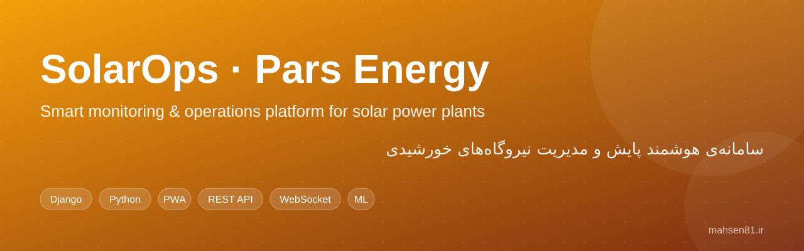
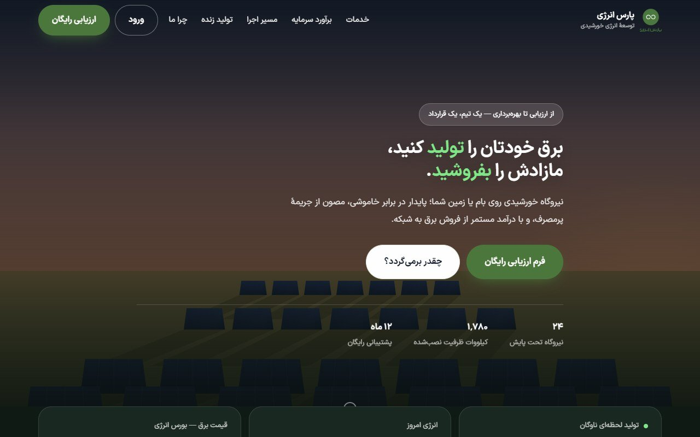
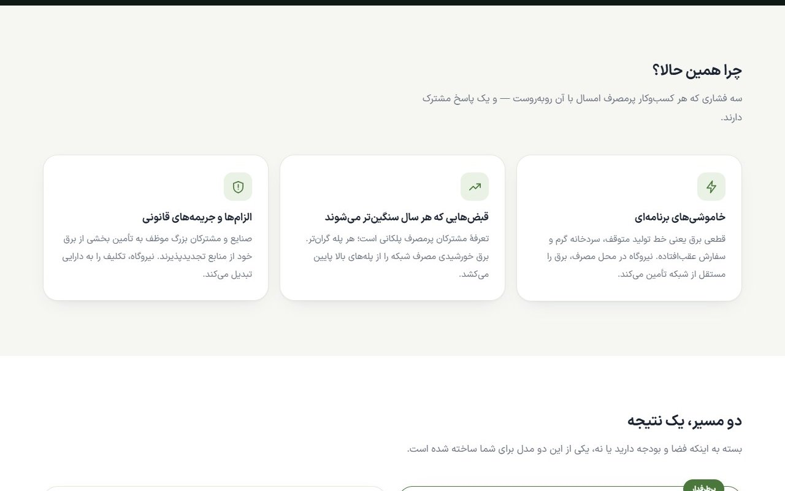
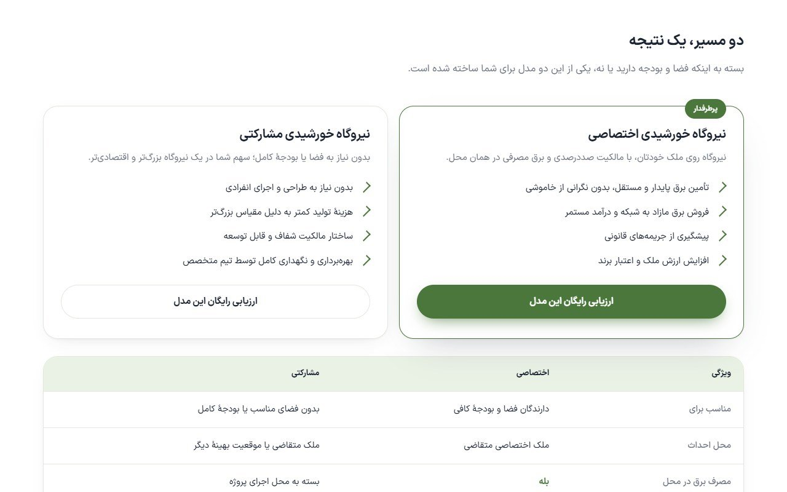
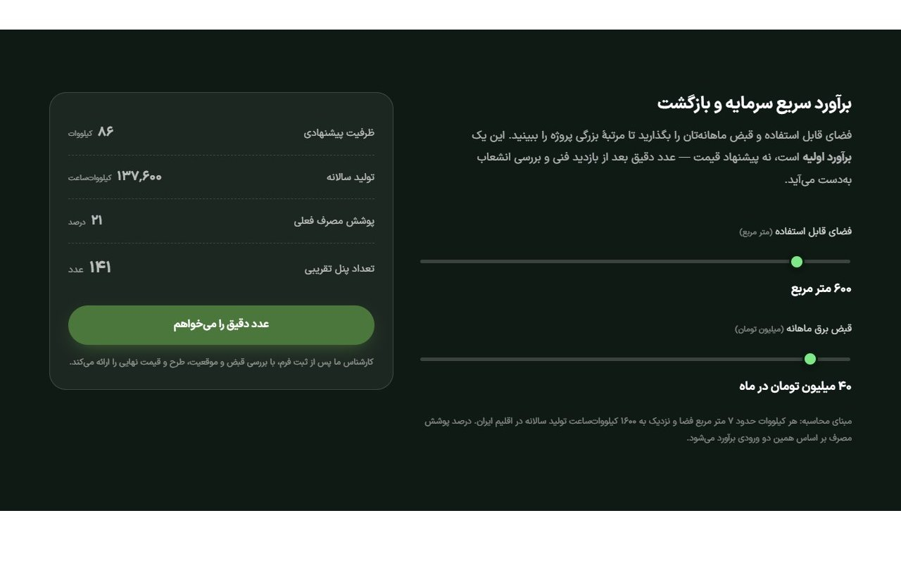
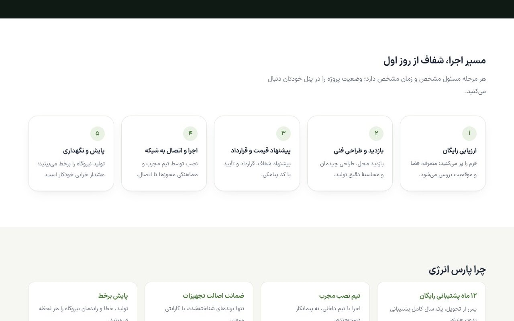
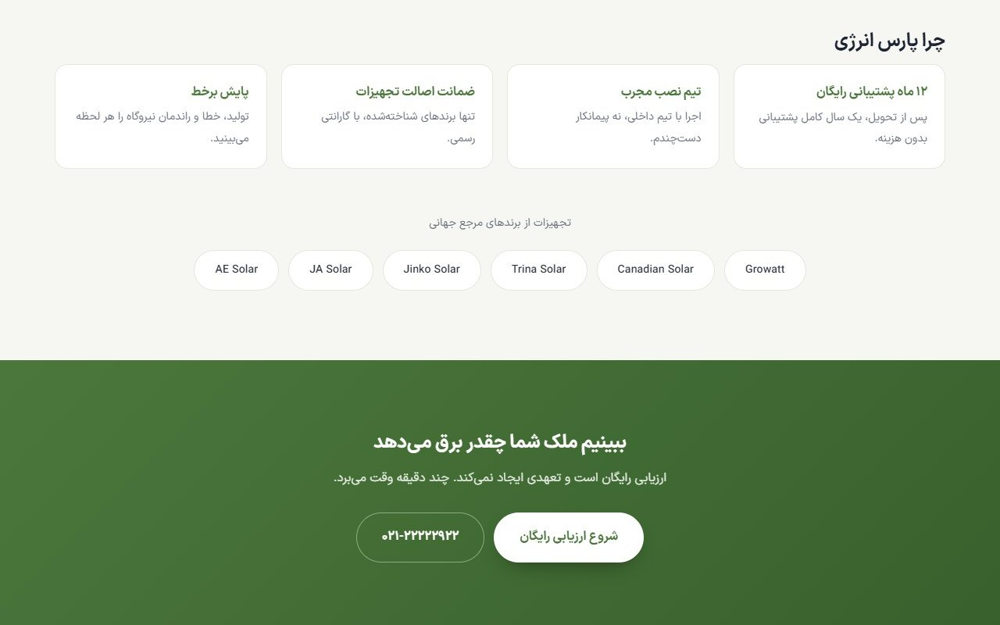
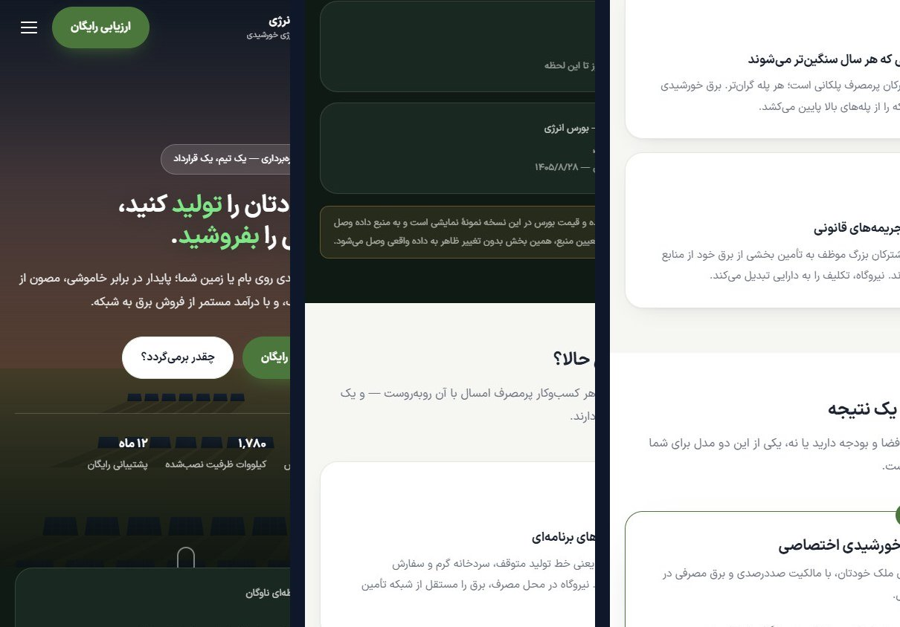

<!-- gen:header -->
<p align="center"></p>

<h1 align="center">SolarOps · Pars Energy</h1>
<p align="center"><b>سامانه‌ی هوشمند پایش و مدیریت نیروگاه‌های خورشیدی</b><br><i>Smart monitoring & operations platform for solar power plants</i></p>
<p align="center">     </p>

> 💼 **این محصول آماده‌ی استقرار برای کسب‌وکار شماست.** نسخه‌ی اختصاصی با برند خودتان، راه‌اندازی روی سرور و پشتیبانی: [mahsen81.ir](https://mahsen81.ir)

<div dir="rtl">

## ✨ امکانات

- پایش لحظه‌ای نیروگاه، اینورتر، سنسور و کنتور با داشبورد زنده
- هشدار هوشمند خرابی و افت راندمان، با تحلیل و یادگیری ماشین
- ماژول کامل فروش: ثبت درخواست مشتری، پیش‌فاکتور، قرارداد، پرداخت و پیامک
- گزارش‌ساز Excel و PDF و پیشنهاد قیمت خودکار
- اتصال به اینورترهای Solax و API برای اپ موبایل
- نقش‌ها و دسترسی‌ها، احراز هویت دومرحله‌ای (MFA) و PWA قابل نصب روی گوشی


</div>

## 🎯 برای چه کسانی؟

- **شرکت‌های EPC و نصاب نیروگاه خورشیدی**: از جذب مشتری تا تحویل و پشتیبانی، در یک سامانه
- **مالکان نیروگاه و صنایع پرمصرف**: پایش تولید، درآمد فروش برق و هشدار خرابی
- **سرمایه‌گذاران نیروگاه مشارکتی**: گزارش شفاف تولید و سهم هر سرمایه‌گذار

## 🧩 معماری

| لایه | فناوری |
|---|---|
| بک‌اند | Django ماژولار (accounts، plants، monitoring، alerts، leads، requests، reports) |
| داده‌ی لحظه‌ای | WebSocket و SSE برای تله‌متری |
| تحلیل | ماژول‌های ML برای پیش‌بینی تولید و تشخیص ناهنجاری |
| استقرار | Docker، docker-compose یا cPanel با Passenger |
| فرانت | داشبورد PWA واکنش‌گرا و سایت فرود فارسی |

## 📈 چرا SolarOps؟

- **صفر تا صد در یک پلتفرم**: لازم نیست CRM، اکسل و پنل اینورتر را جدا جدا نگه دارید
- **بومی ایران**: تقویم شمسی، پیامک، تعرفه‌های پلکانی و قوانین مشترکان پرمصرف
- **ماشین‌حساب بازگشت سرمایه** روی سایت که بازدیدکننده را به سرنخ فروش تبدیل می‌کند
- **قابل سفارشی‌سازی** برای برند و فرایندهای شرکت شما

## 📸 تصاویر · Screenshots

<p align="center">       </p>

## 🚀 Quick start

```bash
python -m venv .venv && .venv\Scripts\activate
pip install -r requirements.txt
copy .env.example .env
python manage.py migrate
python manage.py createsuperuser
python manage.py runserver
```

---

<!-- gen:docs -->
## 📚 مستندات کامل · Full documentation

# SolarOps

سامانه پایش و مدیریت نیروگاه‌های خورشیدی با معماری ماژولار، API، داشبورد، PWA، گزارش‌ساز و ماژول‌های تحلیل و یادگیری ماشین.

## اجرای محلی
1. ساخت محیط مجازی و نصب وابستگی‌ها از فایل requirements.txt
2. کپی کردن .env.example به .env
3. اجرای migration
4. ایجاد ادمین
5. اجرای سرور توسعه

## ماژول‌ها
- accounts: احراز هویت، نقش‌ها، MFA
- plants: نیروگاه، اینورتر، سنسور، کنتور
- monitoring: داده‌های لحظه‌ای، تله‌متری، WebSocket/SSE
- alerts: آستانه‌ها و اعلان‌ها
- analytics: KPI، مالی، راندمان، افت تولید
- reports: PDF و Excel
- ml: پیش‌بینی تولید، تشخیص خطا، پیشنهاد تعمیر
- api: REST API و مستندات OpenAPI
- pwa: manifest و service worker
- requests: درخواست مشتری، پیشنهاد قیمت، قرارداد، پرداخت داخلی، OTP و پیامک

## دوزبانه و تقویم دوگانه
- رابط کامل **انگلیسی/فارسی** (i18n) با سوییچر زبان و RTL↔LTR خودکار. منبع ترجمه: کاتالوگ `locale/en` که با `python scripts/build_en_catalog.py` ساخته می‌شود (بدون نیاز به gettext).
- **تقویم شمسی/میلادی**: ذخیره‌سازی میلادی، تبدیل در لایه‌ی نمایش با `jdatetime` و فیلترهای `smartdate`/`smartdatetime`.

## استقرار و مستندات
- [docs/DEPLOYMENT.md](docs/DEPLOYMENT.md) — استقرار با Docker (Postgres + Redis + Gunicorn/ASGI + Celery + Nginx)
- [docs/SERVER_INSTALL.md](docs/SERVER_INSTALL.md) — نصب روی سرور Ubuntu بدون Docker
- [docs/API.md](docs/API.md) — مستندات REST API (و `/api/docs/` به‌صورت تعاملی)

## نکته
- توسعه‌ی محلی روی **SQLite** و بدون Redis اجرا می‌شود (کش/کانال‌ها in-memory). در production با تنظیم `DATABASE_URL` و `USE_REDIS_*` به Postgres + Redis سوییچ می‌کند.

---

<p align="center">ساخته‌شده توسط <a href="https://mahsen81.ir"><b>محسن جباره‌اصل</b></a> — برنامه‌نویسی، طراحی سایت، ربات و هوش مصنوعی<br>
Built by <a href="https://mahsen81.ir">Mohsen Jabbareh-Asl</a> · ⭐ اگر مفید بود، ستاره بدهید · Need a custom version? <a href="https://mahsen81.ir">Get in touch</a></p>
